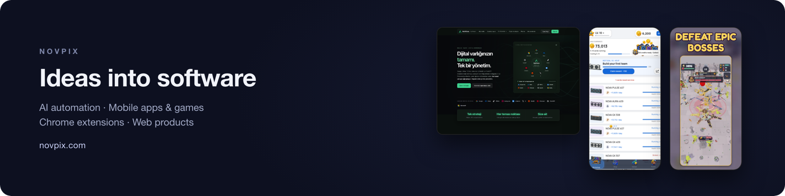

Novpix is a small software studio: Novpix LLC, registered in Delaware, USA, with its development base in Rize, Türkiye. We build and run our own products and take client projects from the first idea to launch: design, development, servers, payments and App Store / Google Play releases.

### Products

| Product | What it is |
| --- | --- |
| [AdsMans](https://adsmans.com) | Advertising platform that brings Google Ads, Meta, TikTok, LinkedIn and Reddit accounts into one panel, with AI-assisted reporting and campaign work |
| [Tabrein](https://tabrein.com) | Chrome extension and MCP server that lets AI agents use a real browser |
| [HASH: Mining Studio](https://play.google.com/store/apps/details?id=com.novpix.hashmining) | Mobile simulation game built with Godot, on Google Play |
| [Blade Orbit](https://play.google.com/store/apps/details?id=com.novpix.bladeorbit) | Online multiplayer arena game: Godot client and an authoritative game server, on Google Play |
| [CardPetal](https://cardpetal.com) | Animated e-cards and 3D gifts built with Three.js |
| [ZumaTools](https://zumatools.com) | Free PDF, image and calculator tools that run in the browser |

Case study: [Berberoğlu Çay](https://novpix.com/work/berberoglu-crm), an ERP/CRM and a Flutter mobile app ([App Store](https://apps.apple.com/tr/app/berbero%C4%9Flu-%C3%A7ay/id6811613475) · [Google Play](https://play.google.com/store/apps/details?id=com.berberoglucay.magaza)) for a tea producer in Rize.

### Open source

[free-html-templates](https://github.com/Novpix/free-html-templates): 17 free, responsive HTML/CSS website templates (MIT). Most of our product code is private.

### Stack

TypeScript · Node.js · Next.js · PostgreSQL · Docker · Godot · Flutter · React Native · Three.js · Claude and OpenAI APIs

### Work with us

We take on AI automation, mobile app, Chrome extension and web projects.

[novpix.com](https://novpix.com) · [LinkedIn](https://www.linkedin.com/company/novpix/) · [Upwork](https://www.upwork.com/freelancers/~01afcecd7cc56c780a)
